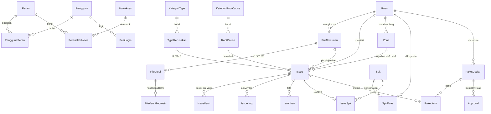

# Database Damage Road (SQL Server)

Folder ini berisi script untuk membuat database Damage Road di **SQL Server Express** (gratis).
Simpan folder ini di repo GitHub sebagai `database/`.

| File | Isi |
|---|---|
| `01_schema.sql` | Semua tabel, relasi, aturan isian, dan view laporan |
| `02_seed.sql` | Data awal: peran, hak akses, type R/S/B + tarif MOU, root cause, pengaturan, akun `admin` |
| `03_cek.sql` | Cek isi database (aman dijalankan kapan saja) |

## Cara menjalankan

1. Buka **SQL Server Management Studio (SSMS)** dan sambungkan ke `localhost\SQLEXPRESS`.
2. Klik kanan **Databases** → **New Database** → nama `DamageRoad` → **OK**.
   Kalau sebelumnya sudah ada database `DamageRoad` hasil latihan, hapus dulu (klik kanan → **Delete**) lalu buat ulang.
3. **File → Open → File…** → pilih `01_schema.sql`. Pastikan dropdown database di toolbar menunjukkan **DamageRoad**, lalu tekan **F5**.
   Di bawah harus muncul: `Skema Damage Road selesai dibuat.`
4. Buka `02_seed.sql` dengan cara yang sama, lalu tekan **F5**.
   Di tab **Results** muncul daftar peran beserta jumlah hak aksesnya.
5. Cek: buka folder **Databases → DamageRoad → Tables**. Harus ada 28 tabel, dan di **Views** ada 3 view.

Kalau muncul pesan error berwarna merah, screenshot pesannya beserta nomor barisnya.

## Akun admin pertama

Script membuat akun **`admin`** **tanpa password**. Ini disengaja supaya tidak ada password bawaan yang ikut tersimpan di GitHub.
Saat pertama kali login nanti, aplikasi meminta admin **membuat password sendiri**.
Password tidak pernah disimpan dalam bentuk asli; yang disimpan hanya hash (bcrypt).

## Peta tabel

## Kelompok tabel

| Kelompok | Tabel | Dipakai untuk |
|---|---|---|
| Login & hak akses | `Pengguna`, `Peran`, `HakAkses`, `PenggunaPeran`, `PeranHakAkses`, `SesiLogin` | Siapa boleh melakukan apa (matriks di dokumen workflow) |
| Pengaturan | `KategoriType`, `TypeKerusakan`, `KategoriRootCause`, `RootCause`, `Pengaturan` | Settings type, root cause, tarif MOU, batas approval |
| Ruas & file | `Ruas`, `FileDokumen`, `FileVersi`, `FileVersiGeometri` | Daftar ruas, file DWG/PNEZD/dokumen dan versinya |
| Issue | `Issue`, `IssueVersi`, `IssueLog`, `Lampiran`, `Zona`, `SaranZonaDitolak` | Titik kerusakan, posisi per versi, riwayat, foto, zona berulang |
| SPK | `Spk`, `SpkRuas`, `IssueSpk` | Data SPK dari SAP/API dan hubungannya ke issue |
| Workflow | `PaketUsulan`, `PaketItem`, `Approval` | Paket usulan perbaikan dan persetujuan Dept/Div Head |
| Audit | `AuditLog` | Catatan semua aksi penting (login, ubah, hapus, approve) |

## View untuk Power BI

| View | Isi |
|---|---|
| `vIssue` | Satu baris per issue, lengkap: ruas, type, status, SPK, zona, overdue, estimasi biaya |
| `vZonaBerulang` | Rekap tiap zona: berapa kali rusak, kejadian pertama & terakhir |
| `vHakAksesPengguna` | Hak akses efektif setiap pengguna (dipakai API saat login) |

## Aturan penting yang dijaga database

- **Kode kerusakan unik per ruas** (`R1` tidak boleh dobel di ruas yang sama), begitu juga nomor issue `#`.
- **Kode ruas dan nama ruas unik** (`BSD0003`, `Row 40B`).
- **Due date tidak boleh sebelum start date.**
- **Status issue, status ruas, folder file, sumber SPK** hanya boleh berisi nilai yang sudah ditentukan.
- **Kolom JSON** (geometri DWG, poligon, detail audit) dicek harus JSON yang valid.
- **File fisik tidak disimpan di database**, hanya lokasinya.

## Langkah berikutnya

1. **API** (penghubung aplikasi ↔ database) dengan login username/password.
2. **Layar login di aplikasi** dan tampilan menu sesuai peran.
3. **Migrasi data** dari file backup `.json` aplikasi ke database ini.
